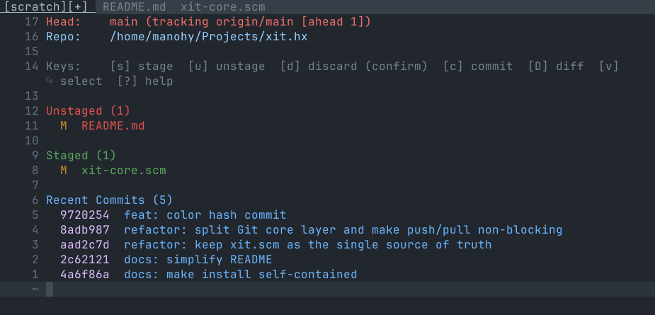

# xit.hx

A Helix-native Git UI written in Steel Scheme.



## Install

Requires Helix with Steel scripting support, `git`, `bash`, `python3`, and a C
compiler (`cc`, or set `CC=gcc` / `CC=clang`).

```bash
git clone https://github.com/j03-dev/xit.hx.git
cd xit.hx
./install.sh
```

The installer copies `xit.scm` and its Git layer `xit-core.scm` into your Steel
cogs, installs `notify.hx`, the `xit` query, language registration, and builds
the grammar. You only require `xit.scm`; the core module is loaded from the same
directory automatically. It does not edit Helix source. Restart Helix after
installing.

## Helix config

This is the only config needed in `~/.config/helix/init.scm`:

```scheme
(require "xit/xit.scm")

(keymap (global)
  (normal
    (space
      (g ":Git")))))
```

`space g` opens the Git status buffer. If you do not want a shortcut, only keep
the `require` line and run `:Git` manually.

All other keys are native Helix or xit buffer keymaps installed automatically.

## Use

| Action | Key |
|---|---|
| Open Git status | `space g` or `:Git` |
| Stage file / section / selection | `s` |
| Unstage file / section / selection | `u` |
| Open commit editor | `c` |
| Commit | type message, then `:w` |
| Abort commit | `q` (Esc stays native and never aborts) |
| Discard changes | `d`, then `y` to confirm |
| View diff | `D` |
| Open file | `ret` |
| Refresh status | `r` |
| Close xit buffer | `q` |
| Show all keys | `?` |

For selection staging, use normal Helix selection (`v`, `V`, `C-j`, multiple
cursors) over file lines, then press `s` or `u`.

More keys in `*git*`: `C` amend commit, `O` / `T` resolve conflicts, `S` / `U`
stage or unstage all, `P` / `p` push or pull.

## Highlighting

Applied automatically:

- `*git*` → `xit` (hashes, subjects, sections, status entries)
- `*git-commit*` → `git-commit`
- `*git-diff*` → `diff`

## Verify

```bash
hx --health xit
```

You should see `Tree-sitter parser: ✓` and `Highlight queries: ✓`.

## Update

```bash
cd xit.hx
git pull
./install.sh
```

Restart Helix after updating.

## If something is wrong

- `:Git` missing: check `(require "xit/xit.scm")` in `init.scm`.
- No highlighting: run `./install.sh` and restart Helix.
- `#false` in the status line: your cog is old; run `./install.sh`.
